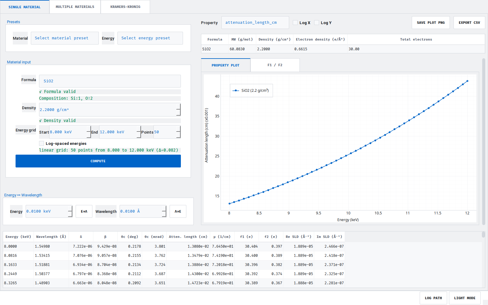

# XRayLabTool

[](https://www.python.org/downloads/)
[](https://badge.fury.io/py/xraylabtool)
[](https://opensource.org/licenses/MIT)
[](https://pyxraylabtool.readthedocs.io/en/latest/?badge=latest)
[](https://github.com/imewei/pyXRayLabTool/actions/workflows/ci.yml)

Python package and CLI for calculating X-ray optical properties of materials using CXRO/NIST atomic scattering factor data. The calculations are JAX-first (float64) and run on the CPU or an NVIDIA GPU.

## Installation

### Using uv (Recommended)

```bash
# Core package (JAX on CPU, CLI, GUI)
uv pip install xraylabtool

# NVIDIA GPU acceleration (pick the CUDA major matching your driver)
uv pip install "xraylabtool[gpu_cuda13]"
uv pip install "xraylabtool[gpu_cuda12]"
```

### Using pip

```bash
pip install xraylabtool
```

### Using conda

```bash
# Core package (CPU only) from the imewei channel; dependencies come from conda-forge
conda install -c imewei -c conda-forge xraylabtool
```

The conda package does not include the CUDA GPU extras; use pip or uv for GPU support.

### Development

```bash
git clone https://github.com/imewei/pyXRayLabTool.git
cd pyXRayLabTool
uv sync
```

## Quick Start

### Python API

```python
import xraylabtool as xlt

# Single material at 10 keV
result = xlt.calculate_single_material_properties("SiO2", 10.0, 2.2)
print(f"Critical angle: {result.critical_angle_degrees[0]:.3f}°")
print(f"Attenuation length: {result.attenuation_length_cm[0]:.2f} cm")

# Multiple materials comparison
materials = {"SiO2": 2.2, "Si": 2.33, "Al2O3": 3.95, "C": 3.52}
results = xlt.calculate_xray_properties(
    list(materials.keys()), 10.0, list(materials.values())
)
for formula, r in results.items():
    print(f"{formula:6}: θc = {r.critical_angle_degrees[0]:.3f}°")
```

### Command-Line Interface

```bash
xraylabtool calc SiO2 -e 10.0 -d 2.2           # Single material
xraylabtool calc Si -e 5-15:11 -d 2.33 -o out.csv  # Energy sweep
xraylabtool convert energy 8.048,10.0 --to wavelength
xraylabtool formula Al2O3                         # Formula analysis
xraylabtool bragg -d 3.14,2.45 -e 8.048          # Bragg angles
xraylabtool batch materials.csv -o results.csv    # Batch processing
xraylabtool kk Si --energies 8,10,12             # Kramers-Kronig f1 from f2 (keV)
xraylabtool completion install                    # Shell tab-completion
```

`xtool` and `xlt` are short aliases for `xraylabtool` (e.g. `xtool calc SiO2 -e 10.0 -d 2.2`).
Shell tab-completion installed via `xraylabtool completion install` works for both names.

### GUI

```bash
xraylabtool-gui        # or the short aliases: xtool-gui, xlt-gui
python -m xraylabtool.gui   # equivalent module form
```

Single-material analysis, multi-material comparison and Kramers-Kronig f1 reconstruction with interactive plots and CSV/PNG export. The window opens maximized.



## Calculated Properties

| Property | Field | Unit |
|----------|-------|------|
| Dispersion coefficient | `dispersion_delta` | dimensionless |
| Absorption coefficient | `absorption_beta` | dimensionless |
| Scattering factors | `scattering_factor_f1`, `f2` | electrons |
| Critical angle | `critical_angle_degrees` | degrees |
| Attenuation length | `attenuation_length_cm` | cm |
| Scattering length density | `real_sld_per_ang2`, `imaginary_sld_per_ang2` | Å⁻² |

All properties are returned as NumPy arrays in the `XRayResult` dataclass, supporting single energies or energy sweeps.

## JAX Backend

All calculations run in JAX with float64 on JAX's default device: the CPU, or the
GPU of a CUDA install (`gpu_cuda12`/`gpu_cuda13` extra). There is no NumPy backend and
no switch to select one; set `JAX_PLATFORMS=cpu` to force the CPU.

- The first compute call compiles a small program (a fraction of a second on CPU); later
  calls with the same shape buckets compile nothing. `xraylabtool.warm_up()` precompiles
  explicitly, and the CLI and GUI keep a persistent compile cache
  (`XRAYLABTOOL_NO_JAX_CACHE=1` opts out).
- `set_backend("jax")` is kept as a no-op; `set_backend("numpy")` raises `ValueError`.
- `xraylabtool.calculators.optics.optical_properties` is a pure device function that works
  under `jax.jit`, `jax.vmap` and `jax.grad`.
- `import xraylabtool`, `--help` and `--version` do not import JAX.

## Scientific Background

Calculations use Henke, Gullikson, and Davis atomic scattering factor tabulations (0.03–30 keV):

- **Refractive index**: n = 1 - δ - iβ
- **Critical angle**: θc = √(2δ)
- **Attenuation**: Beer-Lambert law with μ = 4πβ/λ

## Documentation

Full documentation: **[pyxraylabtool.readthedocs.io](https://pyxraylabtool.readthedocs.io)**

- [API Reference](https://pyxraylabtool.readthedocs.io/en/latest/api/)
- [CLI Guide](https://pyxraylabtool.readthedocs.io/en/latest/guides/cli_reference.html)
- [Architecture Decisions](https://pyxraylabtool.readthedocs.io/en/latest/architecture/)
- [Changelog](CHANGELOG.md)

## Development

```bash
uv sync                          # Install dependencies
uv run pytest                    # Run tests
uv run ruff check .              # Lint
uv run ruff format .             # Format
uv run sphinx-build docs docs/_build/html  # Build docs
make test                        # Or use Makefile shortcuts
```

## Citation

```bibtex
@software{xraylabtool,
  title = {XRayLabTool: High-Performance X-ray Optical Properties Calculator},
  author = {Wei Chen},
  url = {https://github.com/imewei/pyXRayLabTool},
  version = {0.4.8},
  year = {2024--2026}
}
```

## License

MIT, with bundled kkcalc material under Zlib (see [NOTICE](NOTICE)). See [LICENSE](LICENSE) for details.

## Acknowledgments

- [CXRO](https://henke.lbl.gov/optical_constants/) — Atomic scattering factor databases
- [NIST](https://www.nist.gov/) — Reference data and validation
- [kkcalc](https://github.com/benajamin/kkcalc) (Benjamin Watts, Daniel J. Lauk) — Kramers-Kronig transform and tabulated f2 data, ported in `xraylabtool.kk`; method: B. Watts, *Opt. Express* **22**(19), 23628–23639 (2014), doi:10.1364/OE.22.023628
