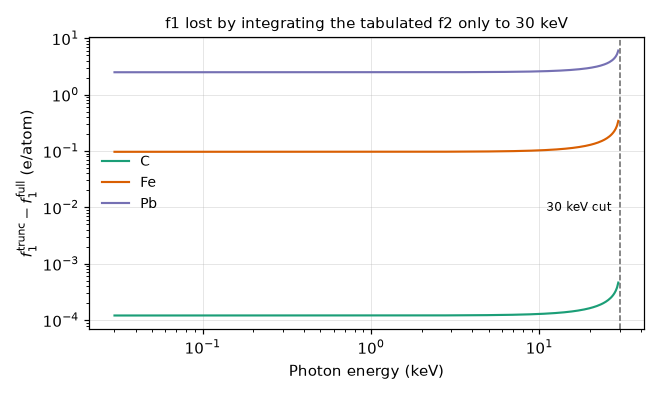

Kramers-Kronig Transform
========================

``xraylabtool.kk`` computes the real part of the atomic scattering factor,
:math:`f_1`, from the imaginary part, :math:`f_2`, with the piecewise Laurent
polynomial method of Watts (2014). This page states the equations as the code
implements them, where the implementation follows the paper, and where it
departs from it. Equation numbers refer to Watts 2014 (see References). The
API is described in :doc:`../api/kk` and usage in :doc:`../guides/kk_guide`.

Scattering factors and the dispersion relation
----------------------------------------------

In the Henke convention the refractive index is :math:`n = 1 - \delta - i\beta`,
with both parts proportional to sums of atomic scattering factors over the
elements :math:`q` of the material (see :doc:`xray_optics`):

.. math::

   \delta = \frac{r_e \lambda^2}{2\pi} \sum_q N_q f_{1,q}, \qquad
   \beta = \frac{r_e \lambda^2}{2\pi} \sum_q N_q f_{2,q}

:math:`f_1` and :math:`f_2` of one formula unit are related by the
Kramers-Kronig transform (Watts 2014, Eq. (1)). Written with the sign used in
the code and in its tests:

.. math::

   f_1(E) = Z^* + \frac{2}{\pi}\,
   \mathrm{P}\!\int_0^\infty \frac{x\, f_2(x)}{E^2 - x^2}\,\mathrm{d}x

where :math:`\mathrm{P}` is the Cauchy principal value and :math:`Z^*` the
relativistically corrected electron count (Eq. (9), below). With this sign a
constant :math:`f_2 = c` on :math:`[a, b]` gives
:math:`f_1 - Z^* = (c/\pi)\ln\lvert (E^2-a^2)/(E^2-b^2)\rvert`, and a single
Lorentz oscillator has :math:`f_1 - Z^* < 0` below resonance and :math:`> 0`
above it; both closed forms are checked in ``tests/unit/kk/test_transform.py``.

Piecewise Laurent representation
--------------------------------

The tabulated :math:`f_2` of every element is stored as a polynomial in
:math:`x` and :math:`1/x` on each interval :math:`x_j \le x < x_{j+1}`
(Watts 2014, Eq. (8)):

.. math::

   f_2(x) = a_{j,1}\,x + a_{j,0} + a_{j,-1}\,x^{-1}
            + a_{j,-2}\,x^{-2} + a_{j,-3}\,x^{-3}

The coefficient arrays have five columns in this order,
``A_1, A_0, A_-1, A_-2, A_-3`` (``coeffs[:, 0]`` to ``coeffs[:, 4]``), one row
per interval, and one more knot than rows. Knots and coefficients are in
**eV**: :math:`a_{j,n}` has units of electrons·eV\ :sup:`-n`, so expressing
:math:`x` in keV would rescale each column by :math:`1000^{n}`. For this reason
the transform runs in eV internally and the public functions convert keV
inputs once, at the boundary.

A compound is the stoichiometric sum of its elements: the coefficient tables
are re-cut on the union of all elemental knots and added with the formula
counts (:func:`~xraylabtool.kk.spectrum.compound_spectrum`).

Closed form per interval
------------------------

Because each term of Eq. (8) is a power of :math:`x`, the integral over one
interval has a closed form. For an energy :math:`E` that is not a knot, the
sum over the :math:`i` intervals is (Watts 2014, Eq. (10), with the
:math:`a_{j,-3}` term corrected as explained in the erratum below):

.. math::

   f_1(E) = Z^* + \frac{1}{\pi E} \sum_{j=1}^{i} \Bigg\{
     & \Big(E^2 a_{j,1} - E a_{j,0} + a_{j,-1} - \frac{a_{j,-2}}{E}
          + \frac{a_{j,-3}}{E^2}\Big)
     \ln\left\lvert \frac{x_{j+1}+E}{x_j+E} \right\rvert \\
   & - \Big(E^2 a_{j,1} + E a_{j,0} + a_{j,-1} + \frac{a_{j,-2}}{E}
          + \frac{a_{j,-3}}{E^2}\Big)
     \ln\left\lvert \frac{x_{j+1}-E}{x_j-E} \right\rvert \\
   & - 2E a_{j,1}\,(x_{j+1}-x_j)
   + \frac{2a_{j,-2}}{E} \ln\left\lvert \frac{x_{j+1}}{x_j} \right\rvert
   + \frac{2a_{j,-3}}{E} \left(x_j^{-1} - x_{j+1}^{-1}\right) \Bigg\}

The same sum, arranged by coefficient (the layout of the paper's Table 1;
every entry is multiplied by :math:`1/(\pi E)`, a blank means the term does
not occur and 0 means the contributions cancel):

.. list-table:: Coefficient of each term of the corrected Eq. (10)
   :header-rows: 1
   :stub-columns: 1

   * -
     - :math:`x_{j+1}^2 - x_j^2`
     - :math:`x_{j+1} - x_j`
     - :math:`\ln\lvert\frac{x_{j+1}+E}{x_j+E}\rvert`
     - :math:`\ln\lvert\frac{x_{j+1}-E}{x_j-E}\rvert`
     - :math:`\ln\lvert\frac{x_{j+1}}{x_j}\rvert`
     - :math:`x_{j+1}^{-1} - x_j^{-1}`
   * - :math:`a_{j,1}`
     - 0
     - :math:`-2E`
     - :math:`E^2`
     - :math:`-E^2`
     -
     -
   * - :math:`a_{j,0}`
     -
     - 0
     - :math:`-E`
     - :math:`-E`
     -
     -
   * - :math:`a_{j,-1}`
     -
     -
     - 1
     - -1
     -
     -
   * - :math:`a_{j,-2}`
     -
     -
     - :math:`-1/E`
     - :math:`-1/E`
     - :math:`2/E`
     -
   * - :math:`a_{j,-3}`
     -
     -
     - :math:`1/E^2`
     - :math:`-1/E^2`
     - 0
     - :math:`-2/E`

:func:`~xraylabtool.kk.transform.kk_piecewise_poly` evaluates this sum. It keeps the
arithmetic of upstream kkcalc's ``KK_PP`` term by term (decision D1) so that the
two agree to rounding; an independent transcription of the corrected Eq. (10)
agrees with it to 1.8e-8 (Si), 4.9e-8 (SiO\ :sub:`2`), 9.6e-9
(C\ :sub:`8`\ H\ :sub:`8` with near-edge data) and 3.6e-5 (Au) in absolute
:math:`f_1` (``test_matches_paper_eq10_as_corrected``); the Au difference is
rounding in the cancelling terms (see Accuracy).

.. admonition:: Erratum: sign of the :math:`a_{j,-3}` term in the typeset Eq. (10)
   :class: warning

   The published Eq. (10) ends in
   :math:`+\frac{2a_{j,-3}}{E}\left(x_{j+1}^{-1} - x_j^{-1}\right)`. That sign is
   wrong. Integrating the :math:`a_{j,-3}` term directly, with
   :math:`x \cdot x^{-3}/(E^2-x^2) = E^{-2}\left(x^{-2} + (E^2-x^2)^{-1}\right)`,
   gives :math:`+\frac{2a_{j,-3}}{E}\left(x_j^{-1} - x_{j+1}^{-1}\right)`
   inside the bracket, as written above. The paper's own Table 1 has this sign
   (:math:`-2/E` in the :math:`x_{j+1}^{-1} - x_j^{-1}` column), and so does
   upstream ``KK_PP``.

   ``test_printed_eq10_a3_subscripts_are_off_by_one`` in
   ``tests/unit/kk/test_transform.py`` checks this against Cauchy quadrature of
   a pure :math:`a_{j,-3}` interval. The corrected term agrees to 1e-12
   relative. The printed sign is wrong by 0.73, 0.067 and 0.015 at the three
   test energies. On the Au data the printed sign changes :math:`f_1` by up to
   9.8e7 (at 10.3 eV). That figure was computed for this page with the test
   module's Eq. (10) transcription; the test does not assert it. The code
   implements the corrected term. In low-resolution renderings of the page the
   ``+`` in the subscript :math:`j+1` can look like a minus sign. The printed
   subscripts are :math:`j+1` and :math:`j`, so the error is in the sign, not
   in the indices.

Singularities at knots and end points
-------------------------------------

The logarithms :math:`\ln\lvert x_j - E\rvert` diverge when :math:`E` equals a
knot. The paper handles an interior knot by treating the two intervals that
meet there together (Watts 2014, Eqs. (5) and (6)). If :math:`x f_2(x)` is
continuous at :math:`x_j`, the divergent parts from the two sides are equal
and opposite and cancel, leaving the finite principal value. That argument
needs an interval on both sides and a continuous :math:`f_2`. It therefore
says nothing about the first or last knot of the data, or about a knot where
:math:`f_2` jumps, and at those points the principal value itself diverges
logarithmically.

The code applies these conventions (decision D5). The first one is a limit; the
other two are conventions, not limits:

- **Interior knot, continuous** :math:`f_2`: the two divergent logarithms are
  dropped and replaced by
  :math:`P_j(x_j)\ln\lvert (x_{j+1}-x_j)/(x_{j-1}-x_j)\rvert`, with
  :math:`P_j(E) = E f_2(E)` evaluated on the interval that starts at
  :math:`x_j`. This is the principal value, continuous in :math:`E`.
- **Interior knot where** :math:`f_2` **jumps**: the same expression, which
  gives upstream's finite value. Golden points pin it, e.g. Ar at 15.7 eV
  (:math:`f_1 = -12.653`) and Ne at 21.5 eV (:math:`-3.826`).
- **First or last knot**: the boundary interval's divergent logarithm is
  dropped with no replacement, again upstream's finite value.

In the vendored data, absorption edges are steep but narrow intervals, so
:math:`f_2` is continuous at them (relative gap below 1e-9). Real jumps occur
only for He (24.5 eV), Ne (21.5 eV), Ar (15.7 eV) and Kr (14.0 eV), with
negligible ones for Xe (12 eV, 3.7e-6 relative) and H. The default output
grid therefore rarely lands on a jump. Energies passed in keV are multiplied
by 1000 once. For about 1.6 % of tabulated knots that product is one ulp away
from the knot, so the result is evaluated just beside the knot: this does not
matter where :math:`f_2` is continuous, but at one of the jump knots above it
returns a one-sided value instead of the D5 convention.

Integration limits
------------------

Eq. (1) integrates from 0 to infinity. Applied to the first and last
intervals, the closed form stays finite only if the polynomials vanish
appropriately (Watts 2014, discussion after Eq. (7)). The interval that starts
at 0 must have :math:`a_n = 0` for every :math:`n < 0`, so that the transform
stays finite as :math:`x \to 0`. The interval that extends to infinity must have
:math:`a_n = 0` for every :math:`n \ge -1`, so that the integrand decays fast
enough.

The tables combine Henke data from 10 eV to 30 keV (point values joined by
straight lines, i.e. only :math:`a_{j,1}` and :math:`a_{j,0}` nonzero) with
Biggs-Lighthill photoabsorption fits up to 500 keV (terms of degree 0 to
:math:`-3`). Above 500 keV the Biggs-Lighthill polynomials have nonzero degree
0 and :math:`-1` terms, which breaks the condition for the last interval, so
that range cannot be used. The vendored data and the transform therefore
cover **10 eV to 500 keV**, with :math:`f_2 = 0` outside.
:func:`~xraylabtool.kk.api.kk_calculate_real` rejects requested energies outside
that range with :class:`~xraylabtool.exceptions.EnergyError`, and
nothing is extrapolated. Only :meth:`~xraylabtool.kk.result.KKResult.to_xray_result`
restricts energies further, to the package's 0.03-30 keV range (D3).

Relativistic correction and workflow
------------------------------------

The integration constant is the high-energy limit of :math:`f_1`
(Watts 2014, Eq. (9)), summed over the elements with counts :math:`n_q`:

.. math::

   Z^* = \sum_q n_q \left( Z_q - \left(\frac{Z_q}{82.5}\right)^{2.37} \right)

It is added exactly once per formula unit, not once per element table.

The paper lists six steps for computing the scattering factors of a material.
They map onto the package as follows:

.. list-table::
   :header-rows: 1
   :widths: 8 46 46

   * - Step
     - Paper
     - Implementation
   * - 1
     - Look up each element's :math:`f_2` and add them with the stoichiometry
     - :func:`~xraylabtool.kk.database.load_asf`, :func:`~xraylabtool.kk.spectrum.compound_spectrum`
       (formula parsed by :func:`xraylabtool.utils.parse_formula`)
   * - 2
     - Convert a measured spectrum to scattering-factor form and merge it in
     - :func:`~xraylabtool.kk.nearedge.load_nearedge`, :func:`~xraylabtool.kk.nearedge.to_asf_scale`,
       :func:`~xraylabtool.kk.nearedge.merge_spectra`
   * - 3
     - Relativistic correction, Eq. (9)
     - :func:`~xraylabtool.kk.transform.relativistic_correction`
   * - 4
     - :math:`f_1` at the requested energies, Eq. (10)
     - :func:`~xraylabtool.kk.transform.kk_piecewise_poly`, called in validated chunks by
       :func:`~xraylabtool.kk.transform.kk_real_spectrum`
   * - 5
     - :math:`f_2` at the requested energies, Eq. (8)
     - :func:`~xraylabtool.kk.spectrum.evaluate_f2`
   * - 6
     - Return energies, :math:`f_1` and :math:`f_2` together
     - :func:`~xraylabtool.kk.api.kk_calculate_real` returning
       :class:`~xraylabtool.kk.result.KKResult`

:func:`~xraylabtool.kk.refine.refine_spectrum` (adaptive insertion of midpoints) is
upstream's ``improve_accuracy`` and is not part of the paper.

Accuracy
--------

**What the paper shows.** Watts (2014) tests the method on the analytic model
of Ohta and Ishida, an antisymmetric Lorentzian pair, approximated by
polynomials with terms of 4th to 0th order. The rms deviation from the
analytic transform over 1000-3000 cm\ :sup:`-1` is 2.4e-7. That test needs
positive powers up to :math:`x^4`. The kernel here has the fixed five terms of
Eq. (8) (D1), so it cannot reproduce that test, and no such claim is made.

**What this implementation shows** (measured values from the test suite):

- *Upstream parity.* Against golden outputs of kkcalc at the pinned commit
  (Si, Au, SiO\ :sub:`2`, Ar, Ne, a synthetic spectrum, and polystyrene with
  its upstream near-edge example), the NumPy backend agrees to 1.2e-12
  relative or better. The jitted JAX kernel rounds differently, so its
  tolerance has a rounding-scale term. The worst case is 6.0e-5 absolute (Au
  at 13.1 eV, :math:`f_1 = -0.0204`).
- *Independent quadrature.* Each of the five basis terms on its own matches
  Cauchy principal-value quadrature to 8.4e-16 relative. A four-interval
  spectrum with all twenty coefficients nonzero matches to 7.8e-15. A
  constant band matches its closed form to 3.4e-15.
- *Lorentz oscillator.* A single oscillator sampled on 2000, 4000 and 8000
  points reproduces the analytic :math:`f_1` to 6.0e-4, 1.55e-4 and 4.8e-5.
  The error falls as :math:`h^2`, as expected for the discretisation error of
  the piecewise-linear input; it is not a property of the transform.
- *Tabulated CXRO* :math:`f_1`. For the 83 elements outside the nine below,
  the transform of the tabulated :math:`f_2` was compared with the
  :math:`f_1` tables at their own energies (30 eV-30 keV, metric
  :math:`\lvert\Delta f_1\rvert / \max(\lvert f_1\rvert, 1)`). The pooled
  median is 1.9e-4 and the 95th percentile 8.9e-3. The worst per-element
  median is 2.8e-3 (Lu). Points that sample an absorption edge deviate much
  more, by tens of percent at the worst edge points, because the tables sample
  the edge at discrete energies while the Henke data resolve it in a narrow
  interval. The test therefore bounds the distribution, not the maximum.
- *Conditioning.* For heavy elements at low energy the interval terms are far
  larger than their sum: for Au at 13 eV, terms near 7.9e12 add up to about
  3e3. Below about 20 eV, :math:`f_1` of such elements is good to only about
  1e-4 absolute in float64. Upstream has the same limit. The default output
  grid starts at 30 eV.

Truncating the integral at 30 keV
---------------------------------

The 30-500 keV tables matter even when only energies below 30 keV are wanted.
The figure shows the change in :math:`f_1` when :math:`f_2` is integrated only
up to 30 keV instead of 500 keV. It is negligible for carbon, visible for iron
and large for lead, the same trend the paper reports for these elements:

   :math:`f_1^{\rm trunc} - f_1^{\rm full}` against photon energy (log-log).
   Generated by ``docs/_static/kk/make_truncation_figure.py`` from this
   package's own code.

.. list-table:: :math:`f_1^{\rm full} - f_1^{\rm trunc}` (electrons per atom), pinned by ``test_30kev_truncation_matches_paper_trend``
   :header-rows: 1

   * - Element
     - 0.1 keV
     - 1 keV
     - 10 keV
     - 29 keV
   * - C
     - -1.21e-4
     - -1.21e-4
     - -1.29e-4
     - -3.79e-4
   * - Fe
     - -0.0968
     - -0.0969
     - -0.1027
     - -0.2831
   * - Pb
     - -2.497
     - -2.497
     - -2.589
     - -5.229

The deficit is always negative and grows near the cut. The ``.nff`` tables
used by ``xraylabtool calc`` stop at 30 keV, so they cannot supply this
contribution. The ``kk`` module therefore carries its own data.

Data source and the nine differing elements
-------------------------------------------

The transform uses upstream kkcalc's ``ASF.json`` unchanged, repacked to
``xraylabtool/data/kkcalc/asf.npz`` (decision D2). It is not rebuilt from the
package's ``.nff`` files: those lack the 30-500 keV Biggs-Lighthill data, and
a rebuild would break the comparison with upstream. For 83 elements the two
sources give the same :math:`f_2` at the ``.nff`` energies, with relative
differences up to 3.8e-11 (Y). For nine elements they differ: **Sc, Mo, Ru,
Be, Ti, Si, La, Gd and W**, with maximum relative deviations from 0.48 up to
7.4 (Sc). For these elements ``xraylabtool kk`` and ``xraylabtool calc`` give
different :math:`f_2`, and their KK :math:`f_1` is not compared with the
tabulated :math:`f_1`. The set is pinned by ``test_nff_divergent_elements``.

References
----------

- B. Watts, "Calculation of the Kramers-Kronig transform of X-ray spectra by a
  piecewise Laurent polynomial method", *Opt. Express* **22**\ (19),
  23628–23639 (2014), doi:10.1364/OE.22.023628. Equations are re-typeset; the
  text and figures here are this project's own.
- Kramers-Kronig Calculator (kkcalc), https://github.com/benajamin/kkcalc,
  commit f331ca31a654af946f7d550a22cf4e9c11fa8afc, zlib/libpng licence (see
  :doc:`../guides/kk_guide` and ``NOTICE``).
- B. L. Henke, E. M. Gullikson and J. C. Davis, "X-ray interactions:
  photoabsorption, scattering, transmission, and reflection at E = 50-30,000
  eV, Z = 1-92", *At. Data Nucl. Data Tables* **54**, 181-342 (1993).
